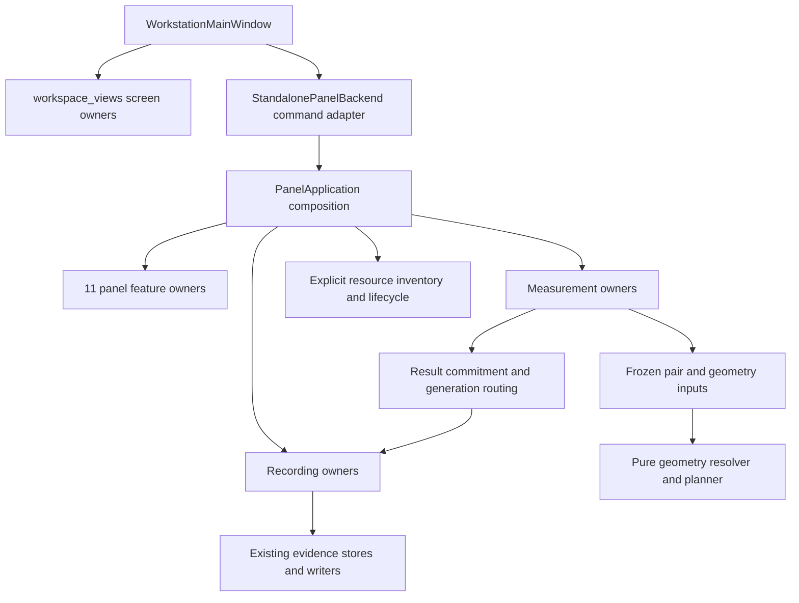

# Workstation ownership and module boundaries

This describes the verified software architecture after the fixed remaining-module follow-up.
Final isolated regression: **2,696 passed, 1 unsupported-NVENC skip, 0 failures, 0 warnings**.
The 649 Python source hashes and delegate stub match the tested candidate. The
[current status audit](changes/20261010-remaining-module-decomposition/status-audit.md) separates
completed ownership changes from hardware and memory qualification limits; the
[verification ledger](changes/20261010-remaining-module-decomposition/verification.md) preserves
both earlier failures and the final evidence.
Operator workflows and data contracts are described in [workflow](../workflow.md),
[Measurement runtime contract](MEASUREMENT_RUNTIME_CONTRACT.md), and [recording schema](RECORDING_SCHEMA.md).

## Source folder map

`Workstation/` keeps the stable package name and launch surface. `__main__.py` is the direct
module entry point, `run.sh` prepares the runtime environment, and `README.md`, `workflow.md`,
`Pixhawk.md`, and `WIRIS.md` describe operator setup and workflows. Feature implementation lives
in responsibility-based packages:

| Folder | Responsibility |
|---|---|
| `application/` | App composition, lifecycle, command contracts, and evidence coordination |
| `controllers/` | UI-facing controllers and orchestration adapters |
| `ui/`, `workspace_views/`, `panel/` | Shared widgets, workspace screens, and panel feature views |
| `measurement/`, `recording/`, `calibration_workflow/`, `optical_pose/` | Measurement, persistence, calibration, and optical-pose workflows |
| `camera_feature/`, `camera_runtime/`, `device_runtime/`, `gnss_runtime/`, `wiris_workers/` | Device and camera capabilities, runtime state, and WIRIS workers |
| `workers/`, `command_bindings/`, `evidence_views/` | Background jobs, command wiring, and evidence projections |
| `workstation_core/` | Shared domain contracts, geometry, transport, and storage primitives |
| `tools/`, `tests/`, `docs/` | Developer utilities, automated checks, and project records |

Compatibility modules live in `compat/`; they preserve supported older import paths and should
delegate one way to the owning package. `runtime_paths.py`, package metadata, and checked-in model
manifests stay at the package root because they are shared bootstrap or asset-discovery contracts.
The move inventory is recorded in
[`changes/20261011-folder-organization/moves.json`](changes/20261011-folder-organization/moves.json).

## Composition and dependency direction



The old module import paths remain named compatibility boundaries. They do not hold copies of
feature business state. New code imports the actual owner. The planned removal conditions are in
[compatibility-exit.md](changes/20261010-god-module-decomposition/compatibility-exit.md).

## Screen owners

`workspace_views/` contains concrete overview, experiment, camera, time-sync, session,
measurement, Pixhawk, telemetry, base-GNSS, alignment, calibration, advanced, recording and
diagnostics views. Camera preview, optical pose, network helpers, PX4 widgets and generic
presentation helpers are separate leaves. `workspaces.py` only reexports supported names.

Screen modules must not import the compatibility facade or unrelated screens. MainWindow and
BaselineYaw90 import concrete owners. `test_workspace_architecture.py` checks all declared screen/component modules in
separate processes, the allowed transitive import graph, identity aliases, and cycle/back-import
negative cases. A large cohesive screen is still a view owner; file size is not the only boundary test.

Calibration, Optical Pose and Pixhawk roots compose their corresponding `*_parts/` owners:

| Screen | Component-owned state and public boundary |
|---|---|
| Calibration | Capture/zoom controls, Live/FTP preview, session/file selection and thumbnails, quality/outlier review, random-validation controls. The outer legacy adapter resolves named capture/quality/diagnostics/setup snapshots and commands; parts never receive the backend or panel. |
| Optical Pose | Frozen native annotation buffers, suggestion acceptance/provenance, candidate/DOF selection, RTK observations, method controls and live-reference display. The same frame/hash/native-grid identities cross the component boundary. |
| Pixhawk | Connection/candidate controls, attitude, GNSS/baseline, magnetometers/parameter display and Drone geometry. Typed display inputs reduce resource handles to side/status values; device commands remain explicit callbacks. |

Compatibility properties refer to the same widgets, models and selection stores. Existing
section order, table selection/scroll behavior and source-index routing are retained. The
Calibration input-helper edge still supports its finite `__new__` callers. Preview and validation
own the existing 500/1000/700 ms timers, exposed by `view_timers()`; `dispose_view_resources()`
stops them and invalidates thumbnail work. Preview frame/detection/stats signals use side-bound
QObject receivers. Disposal disconnects only this view's subscriptions and rejects already queued
callbacks before they can touch retired widgets; capture/quality subscriptions have the same guard.
The architecture gate now resolves all 49 nested modules by qualified name and checks explicit
imports separately from implicit package initialization, avoiding false cycles from re-exports.

## Panel application and state

`standalone_gui.py` hosts the QWidget and composes the application. `panel_application.py` builds
feature owners and named view parts. Camera, calibration, detection, diagnostics, geometry,
alignment, GNSS, lifecycle, presentation, recording-view and settings behavior live in separate
QObject features. Each owns its state and widget references; bounded dependency ports expose only
its required operations/values. External writes are explicitly enumerated; reads are the default.

Named compatibility descriptors route old panel fields to their single actual owner. Assigning a
supported command override affects the same feature command used by the backend. There is no
unrestricted attribute-forwarding context. The Qt widget remains the parent/context for widgets,
workers and timers; moved QObject callbacks retain GUI thread affinity.

Measurement and recording state are their own owners, not duplicated panel feature storage.
`AppLifecycleController` consumes the explicit composite resource inventory, including measurement
actors/timers/queues, native writers/stores, capture/save handles and ordinary feature workers.
Checking only `vars(panel)` is insufficient once a handle lives behind a compatibility property.

Camera endpoint/decoder and WIRIS command widgets now live in `camera_feature/connection_view.py`
and `command_view.py`; candidate state and control operations have their own narrow interfaces.
The 52 Pixhawk connection widgets and four candidate models formerly owned by Camera now belong
to `device_runtime/connection_view.py`'s `PixhawkConnectionView`, stored at
`DiagnosticsViews.connection`. Their 21 view/selection methods moved with the objects. Camera
composition crosses this boundary through three build/snapshot ports rather than recreating the
widget aliases locally. Its declared dependencies fell from 177 to 104, and writable dependencies
from 99 to 38; those counts describe the reviewed boundary, not a correctness criterion.
`stop_all` now asks the actual resource owners to stop and remains incomplete while their real
threads or queued retirement are outstanding.

## Recording owners

`recording_controller.py` composes the recording services and preserves old named calls.
`recording/` separates field formatting and schema projection, raw timelines, video segments,
row collections, session start/stop/recovery/save, photo capture/import records, ULog, metadata,
native submission/completion/retry, primary admission and Qt presentation.

`RecordingState` contains explicit state groups. Native completion and primary persistence share
one admission ledger and RLock. Original row objects, generation, row index and lease stay together;
a late callback cannot identify an owner by numeric row index alone. First terminal outcome,
compact/native deduplication, bounded retries and rollback identities retain their contracts.

The outer binding resolves legacy panel attributes. Behavioral owners receive finite named
capabilities and state. Qt adapters additionally receive the panel through `qobject_parent` solely
to preserve QObject parenting/context; they do not use it as a general state or command interface.
Read-only operations cannot be reassigned through a service port. Save/capture signals retain
their original QObject receivers.

## Measurement owners

`measurement_view_controller.py` is an explicit composition/compatibility boundary.
`measurement/` separates method selection, pairing and capture, geometry input capture, pure
attempt resolution, planning, application-lifetime worker control, commit/retry state, row/result
projection and Qt presentation.

Capture creates `FrozenPairInputs` with `FrozenGeometryInputs`: detection/telemetry, calibration,
scalar configuration, method geometry and selected method/instance are fixed together. The existing
preferred/fallback/hysteresis selector runs at capture. A later settings/profile/selection change
cannot alter the same frozen attempt; there is no implicit first-ready replacement.

`geometry_resolver.py` and the frozen planner do not read widgets, live providers or clocks.
They consume explicit immutable inputs. Result commitment owns pending retries, identity/hash
acceptance, original-generation routing and display decisions. Presentation owns label updates.
Normal Stop keeps application-lifetime method jobs; explicit recovery retains the previously
introduced identity checks and original-run evidence.

## Preserved engineering contracts

- Position/GNSS deltas: NED `[north,east,down]`, metres.
- PX4 orientation: quaternion `wxyz`, body FRD to world NED.
- Optical rays and canonical camera transforms: RDF `[right,down,forward]`.
- Canonical transform: `X_right = R_right_from_left * X_left + T`; camera center `C = -R^T T`.
- Public measurement: optical baseline-center FRD `[forward,right,down,range]`, metres.
- `source_point_left_rdf_m` remains the left-camera point. GNSS local-level midpoint is a separate frame.
- WGS84 angular degrees, ellipsoid/MSL heights and source/host clocks retain distinct fields.

This refactoring introduces no formula, axis, unit, saved-schema or worker-allocation change.
The freeze-boundary tightening enforces the existing promise that a captured pair has fixed inputs.

## Pixhawk data and runtime boundaries

`workstation_core/pixhawk_link/` contains the transport-free values, message
projections and per-link boot-epoch tracker extracted from `pixhawk_attitude.py`:

- `types.py` owns the existing nine telemetry/identity/result dataclasses.
- `decode.py` owns message provenance, raw sensor and timeline projections,
  source-unit scaling, shell-output parsing and attitude conversions.
- `timebase.py` owns the existing uint32 wrap, packet reorder and confirmed
  remote-reboot evidence. It receives host monotonic timestamps explicitly.
- `transport.py` owns connections, endpoint leases, liveness generations,
  receive reservations, deferred telemetry and side-specific send locks.
- `commands.py` owns PARAM/Shell/RTCM/FTP/reboot command composition through
  three explicit transport capabilities; `wire_commands.py` owns wire operations.
- `endpoints.py` owns endpoint validation and bounded USB identity probes;
  `policy.py` keeps existing runtime constants and stream request policy values.

These leaves do not import Qt, pymavlink or the runtime subscriber. Calculation
consumers such as `alignment_managers.py` import the leaves directly. The legacy
`pixhawk_attitude.py` path explicitly reexports the same objects and retains
the Qt subscriber, receive timer, telemetry signal projection and stream policy
coordination. Explicit callbacks connect those concerns to the transport.
Compatibility fields reference the transport's actual connection/lock objects.
The application inventory includes its initialized subscriber resources.

Moved classes retain the legacy `__module__` serialization name so existing
pickle payloads and new payloads use the same class path. That marker does not
import the runtime during a normal leaf import; restoring a legacy pickle still
resolves the compatibility module. Do not infer physical source ownership from
the compatibility marker. Remove it only with a separately supported migration
of serialized consumers. Other compatibility exports can be retired after the
supported import/call inventory has migrated, following the existing exit rules.

Coordinates, field order/defaults, source units, timestamp provenance and
formulas are unchanged. `test_pixhawk_link_boundaries.py` checks fresh-process
headless use, legacy pickle/schema fixtures, known body-FRD/NED rotations,
sensor/timeline projections and explicit boot-clock sequences. The existing
subscriber, UI and recording tests check downstream handoffs. Scope and actual
results are in the [follow-up verification record](changes/20261010-remaining-module-decomposition/verification.md).

## Device connection jobs

`device_runtime/connection_jobs.py` owns the mutually exclusive connect and
disconnect workers/threads. A job-bound QObject receiver preserves GUI thread
affinity, validates the current ticket/subscriber, accepts one terminal result,
and retires only its own handles after QThread.finished. Diagnostics state has
four named compatibility properties backed by those same handles. The feature
selects this typed state through the common construction-time state factory.
Preflight, operator confirmations and widget effects remain at the outer DeviceRuntimeController
boundary; it delegates worker lifetime to the explicit owners below.

`device_runtime/network_roles.py` owns the active NIC-role transaction, captured
requirements/settings, stop-poll timer, and ticket-bound Qt worker/receiver. Six
legacy Camera feature fields now refer to this owner through `camera_feature/state.py`;
they are state rather than view fields. Host success and settings-save failure remain
distinct. A successful OS change is retained if settings persistence fails, with an
explicit failure status and no stranded busy transaction. Untagged compatibility
callbacks cannot alter admitted jobs. Both production and supported legacy owners
are inventoried and have their pending timer stopped during application shutdown.
The existing core NetworkManager transaction retains OS rollback. The dormant old
reconnect/rollback adapters remain compatibility debt; no automatic reconnect policy
was introduced. Pixhawk still requires an explicit Connect after assigning a NIC.

`device_runtime/maintenance_jobs.py` owns the four Shell/PARAM worker/thread maps.
Side/kind lanes preserve existing concurrency and use the original workers and shared
MAVLink command locks. GUI results are accepted once for the captured subscriber,
connection object and connection generation. Stop rejects queued outcomes and retains
real handles until thread exit. Public untagged callbacks are legacy-only; supported
handle aliases and the shutdown inventory point to the actual job owner, including
jobs whose legacy map entry was replaced.

`admin_commands.py` captures six existing administration requests. `admin_jobs.py` owns
MAVFTP per-side slots and the existing global flash/bootstrap/recovery/persistent-config/stream
setup slots, together with transfer/firmware status. `discovery_jobs.py` owns camera-host,
Pixhawk-host and NIC discovery plus the legacy camera-address apply job. Diagnostics state exposes
finite aliases for these actual handles, including the camera discovery/apply and MAVFTP handles
formerly stored by other features. Network-role mutation still goes through its existing owner.

Both new owners use `qt_jobs.py` solely for Qt execution identity, GUI delivery, partial-start
handling and retirement. An operation that actually launched remains admitted after a reported
start error. Stop retains actual handles until the thread exits and queued terminal effects finish;
transfer/firmware evidence remains attached to its admitted request. Inventory also exposes a
live firmware uploader process and jobs hidden by replacement legacy aliases. Shutdown rejects
new admission and waits for actual resource retirement. Existing worker transport/command locks,
USB identity checks and explicit Connect/confirmation policy are unchanged.

`parameters.py` projects the existing core manager's result into a named outcome;
`presentation.py` formats its display. PARAM acceptance/readback never substitutes for actual MAG
selection: Apply still schedules an independent vehicle_magnetometer/Shell observation, and armed,
readback completeness and expected/actual-device checks keep their existing meaning. Sensor
coefficients retain producer axes; ACC offsets are m/s², GYRO offsets rad/s, board offsets degrees
and SENS_BOARD_ROT remains the PX4 enum.

## WIRIS worker owners

`wiris_workers/` separates clock, network, capture, FTP, ordinary control commands
and stream probes. Each QObject keeps its own input/state and I/O lifetime.
Stateless device effects and protocol values have explicit shared modules.
Calibration, optical pose, recording and camera consumers import their concrete
worker owners. `wiris_runtime_workers.py` only reexports supported names, including
the same worker class objects. This move adds no thread or device operation.

## Session storage owners

`workstation_core/session_storage/` separates schema/value projection, spool
state, canonical JSONL, publish/rollback generations, recovery, derived writers
and review, and finalization. The old `recording_session.py` module exports the
same supported objects and has no second spool, transaction or session-ID state.
The existing original-row/generation/admission ownership in `recording/` is
unchanged. Canonical write/readback precedes publication and retry-spool disposal.
Method result paths are registered from the runtime method registry, including
methods without an attempted result.

Finalization now writes canonical rows as a stream, then consumes replayable on-disk rows for
derived output. `disk_index.py` and `indexed_records.py` own generation-local SQLite scratch
indexes for row updates, geometry contexts, time epochs and method records. Those indexes neither
replace the live recording admission ledger nor survive publication/failure cleanup. Their cache
is bounded, while exact ordering, large integer identity, schema, hashes, readback and rollback
remain part of the output contract. Review regeneration uses the same canonical evidence.

Measured 5-stream, review-enabled finalization at 10,000 → 20,000 rows per stream used
206.059 → 212.145 MiB peak RSS and 18.716 → 36.582 s. A separate unique-context/epoch/method-bundle
case at 5,000 → 10,000 rows used 197.965 → 212.371 MiB and 36.967 → 73.196 s.
These are scaling observations, not an unlimited-memory guarantee: an individual large row,
metadata, dynamic schema fields and session measurement inventory remain size-dependent. The
[raw measurements and limits](changes/20261010-remaining-module-decomposition/verification.md#2026-10-11-implementation-status-and-bounded-memory-evidence)
are separate from the pending combined regression.

## Optical calculations and active geometry

`optical_pose/auto_selection.py` receives copied native images and immutable
capture inputs. Jobs carry neither a controller clone nor a live panel.
`horizon.py`, `terrain_solver.py`, `mountain.py` and `drone.py` compute candidates
from explicit profiles, priors and observations. `capture.py` owns frozen-burst state and
HR/OZ worker lifetime with request-time K,D, priors, GNSS, yaw reference and zoom bound to the
admitted session/burst revision. `artifacts.py` owns frame/import and alignment artifact I/O;
imported timestamps keep their declared provenance and do not become inferred exposure times.
`observations.py` and `selection.py` own observation history and review state, while
`candidates.py` retains candidates, priors and rotation context. Compatibility attributes refer
to those same stores. Native u/v, optical RDF and world NED keep the existing formulas,
source identities and observability policies.

`application.py` prepares an optical profile and coordinates apply/revert with the shared
geometry owner. On persistence failure, rollback is conditional on the committed geometry
revision still being current; an older operation cannot overwrite a newer publication or cache.
It keeps restore tokens rather than a second active-geometry store. The outer controller captures
live inputs and supplies explicit storage/geometry/presentation effects.

`workstation_core/active_geometry.py` owns the shared selected/active K,D and R,T
bundle. Calibration and camera features share the same store. Apply/restore
publish geometry values together; detached snapshots do not expose the live
mutable values retained by legacy readers. The existing synchronous Revert
policy is preserved. `calibration_workflow/capture_feedback.py` owns capture-root
counters and inventory caching, independently of widgets and solver jobs.

`calibration_workflow/jobs.py` owns the one shared checkerboard worker/thread slot for
capture, intrinsics, fixed-K/D extrinsics and random validation. The Calibration feature
uses named state aliases and includes the same handles in its shutdown inventory. Job-bound
QObject receivers deliver progress and terminal outcomes on the GUI thread, and retirement
waits for an active callback to return before releasing the slot or starting a continuation.
The original numerical workers, input snapshots and result effects remain unchanged.

The rest of the calibration workflow is divided by responsibility: `capture.py` and
`capture_request.py` own automatic capture state and frozen requests; `inputs.py` owns file and
selection admission, `timing.py` retains native/source-clock eligibility, `quality.py` owns the
existing quality projection, `validation.py` retains random-validation state, and `profiles.py`
owns profile staging/publication and shared-geometry application. `ftp.py` owns WIRIS transaction
handles and OZ queue admission, with `oz_ledger.py` retaining the round ledger. Each FTP transaction
carries its token and original root. Callback depth defers retirement during reentrant completion,
and a new root cannot reassign an already admitted result or consume an unadmitted queue head.

Auto Stop and application shutdown preserve the outcome of a capture already writing files.
Shutdown rejects new jobs and FTP continuations, and waits for queued results as well as
physical thread exit. FTP queue heads are removed only after successful admission; continuations
run after result processing, thread exit and UI cleanup. A thread that actually launched before
reporting a start error remains admitted, so its output is consumed without retrying the same
FTP pair. Source-grid pixels, timing evidence, K,D and optical RDF R,t contracts are unchanged.

## Evidence display and file queries

`evidence_views/` contains telemetry, calibration, connection, GNSS, magnetometer,
geometry, recording and settings projections over explicitly captured values. The outer
`EvidenceAdapter` chooses sources and captures GUI-backed values; pure projection never
re-reads a panel, substitutes newer telemetry, mutates a producer or acquires a new clock.
`snapshot.py` freezes supplied mappings/collections for that handoff. Position frame,
orientation frame, source identity and supplied host-monotonic time remain explicit.

`catalog.py` owns session-catalog/detail queries using an explicit data root, and `artifacts.py`
resolves saved evidence by package-relative paths. File-backed review is separate from live
telemetry projection. `query_runtime.py` executes recording-review file queries with one active
request and at most two pending requests: the latest catalog request and the latest selection/detail
request. Tokens capture data root, session/artifact/measurement selection and result limits;
workers receive no panel, backend or widget. GUI delivery accepts only the current request identity
and returns detached result values, so an old root or selection cannot overwrite a newer display.

The query runtime invalidates delivery immediately on shutdown and cooperatively waits for its
actual thread to retire. It adds no local force-termination rule; the application's existing global
force policy remains applicable. The bounded queue limits pending work rather than changing
artifact schemas, stored coordinates or source timestamps. Integration verification of this path
is in progress with the rest of the frozen source.

## Media stream owners

`workstation_core/media_stream/` owns media responsibilities previously colocated in
`yolo_stream.py`: RTP/RTCP timing and integrity state, recorder queues/encoders,
inference and rate limits, backend readers, frame projection, bounded IPC channels,
child-process assembly and the Qt supervisor. Locks, queues, native-frame leases,
thread counts, decoder fallback and stop deadlines move with their existing owners;
the extraction adds no per-frame copying or new scheduling policy. Source/app clocks
and RGB/BGR/NV12 raster contracts are unchanged. Backend imports of OpenCV, Torch
and GStreamer remain deferred until execution.

The old path explicitly exports the same classes/functions. Serialized classes
retain legacy pickle names; implementation imports are one-way toward concrete
owners. Existing pipeline tests plus fresh-process import, actual spawn/decode/exit
and pre-extraction pickle fixtures check those boundaries. The 20-second synthetic
qualification fails the default RSS-slope gate both before and after extraction;
absolute RSS, IPC/evidence and resource cleanup pass. Those two failures remain unchanged.
A separate current-source 180-second synthetic run passed all 22 original checks with parent RSS
36.508 → 45.965 MiB, peak 50.922 MiB and whole-interval slope 189.028 MiB/h (limit 256 MiB/h).
All 88 saved evidence results were collected and acknowledged, both children exited normally,
and the recorded cleanup found no child/shared-memory leaks. Startup and cleanup samples were
retained; descriptive later windows did not replace the acceptance gate. This observes only
parent RSS in a synthetic workload, not whole-process-tree/GPU memory or field operation.
See [media-extended-180.json](changes/20261010-remaining-module-decomposition/media-extended-180.json)
and its [source snapshot](changes/20261010-remaining-module-decomposition/media-extended-180-source.json).

## Command declarations

`command_bindings/` contains feature-specific declarations for the existing 101
commands. Each registration function receives a registry and named callable actions,
never a window/backend/state object. MainWindow supplies those callbacks and preserves
registration order. The original catalog fixture compares labels, IDs, shortcuts,
categories, deferred completion and every parameterized callback payload. Runtime
command handlers remain at the presentation boundary.

`optical_pose/auto_runtime.py` owns admitted auto-selection worker/thread identity,
queued GUI delivery and retirement. MainWindow supplies frozen jobs and presentation
callbacks; three legacy handle names point to the same owner. PanelApplication
registers every optical runtime in its resource inventory, and backend shutdown
requests Stop from each. Start failures release a non-running reservation. The
existing queued-only cancel and five-second force-stop policy remain; a failed wait
retains the actual task and keeps the window waiting instead of losing its handles.

## Stream startup readiness

`camera_runtime/readiness.py` owns first-frame and MP4-growth readiness plus their
generations. Camera and Presentation feature states refer to the same tracker created
by PanelApplication. Current stream-generation checks remain at the frame adapter;
captured expected-generation, partial/timeout decisions, and positive file-byte growth
are evaluated by the tracker. A failed recording start still permits Measurement to
continue as before. Pane start/stop effects, timers, live recovery, retry/watchdog and
finalization originally remained outer lifecycle responsibilities; their current split
is described below.

`camera_runtime/lifecycle_timers.py` now owns replacement retry and stop-watchdog state
plus actual cancellable QTimers. Four Camera state aliases point to this owner. Existing
100/250ms intervals and the shared 35-second replacement deadline are retained. Job identity
is checked both before a tick and after external pane/finalization callbacks, so reentrant
Cancel or a newer request cannot be overwritten by the old callback. Pane effects, media
finalization and Run completion are explicit ports. Completed Stop cancels its remaining
watchdog; QObject parenting and the resource inventory expose the real timer lifetime.

`recovery.py` now owns current-generation frame admission and one-side live-integrity recovery.
It passes native metadata through without copying image buffers or changing clock/decoder policy.
`finalization.py` owns one pending video teardown publication with the paths and runtime generation
captured at Stop; container presence remains distinct from integrity evidence. `stop.py` sequences
pane retirement, recording evidence and Run completion through explicit ports, checking generation
after callbacks so an old reentrant Stop cannot complete a newer Start. Media processes, recording
transactions and Measurement Run state remain with their existing owners, and real retirement
continues to determine whether shutdown has completed.

## GNSS input and connection owners

`gnss_runtime/credentials.py` resolves captured account/password inputs with the existing
session/keyring/environment priority. Passwords are excluded from value repr. `gga.py`
owns the three skip/throttle fields and computes GGA from explicit selected observations;
controller adapters still choose the current GPS1/GPS2/Base source. WGS84 degrees, MSL
metres, ellipsoid-minus-MSL geoid separation and NMEA wall UTC remain distinct from sample
age in host monotonic seconds. The center-position hint retains its original geodetic mean,
quality=1 and unknown geoid field.

`gnss_runtime/ntrip.py` owns each continuous connection's actual thread, worker, pending
credential and GUI relay. Named GNSS state properties and the shutdown inventory reference
the same binding. Stop, terminal failure and retired identities reject late control events;
ordinary reconnects stay within one binding. Untagged legacy callbacks are accepted only
before a real owner is installed. Coalesced stats carry a binding token through the shared
RTCM pipeline and are unwrapped only for the current active session. Raw envelopes, their
receive UTC/monotonic timestamps, bounded ingress, evidence and drain lifetime are unchanged.
The shared pipeline is not stopped when one NTRIP producer retires.

`base.py` now owns Base serial/discovery resources, survey generation, coordinate samples and
fixed-profile acquisition/readback state. `operation.py` keeps the existing operation-state
coordination. `corrections.py` owns RTCM data-plane and injection resource lifetime, direct raw-queue
wiring and subscriber replacement. `evidence.py` captures immutable measurement/session/root
context tokens, original-envelope attribution and drain high-water state. GNSS feature aliases
and inventory refer to those same owners; the outer controller assembles commands and presents
results. Existing core encoders, protocol validators and the shared Pixhawk transport remain
responsible for device behavior and command exclusion.

NAV-PVT latitude/longitude are WGS84 degrees with ellipsoid and MSL heights separate; NAV-SVIN
mean x/y/z are ECEF metres. CFG-TMODE3 readback retains centimetres plus 0.1 mm high-precision
fields. RTCM bytes, sequence numbers and UTC/host-monotonic receive timestamps retain the original
producer context, including evidence completed after Stop. GUI status delivery and raw RTCM
forwarding remain separate; shutdown waits for producers, ingress/injection and evidence drain
before retiring their actual workers.

## Generated MAVLink protocol

`workstation_core/mavlink_dialects/` keeps the generated module cohesive. Its original
three XML inputs, firmware-compatible XSD, license and input/generator hashes are
repo-owned. `tools/regenerate_mavlink_dialect.py --check` uses pinned pymavlink 2.4.49
and XML validation to reproduce all 235 messages byte for byte. The separate XML
and XSD versions matter: the wheel's bundled definitions are older than the firmware
definitions. The generation manifest records their revisions and the existing SASL
patch. The generated runtime remains unchanged; raw CAN magnetometer units/frame and
wire payload/CRC are checked independently of the generation comparison.

## Verification and test isolation

From the repository root:

```bash
apps/Workstation/tools/run_isolated_tests.sh -q -ra --tb=short
apps/Workstation/tools/run_isolated_tests.sh -q apps/Workstation/tests/test_workspace_architecture.py
python3 tools/check_portable_paths.py
python3 tools/check_repository_policy.py --allow-existing-debt
```

The isolated runner requires Linux unprivileged user/network namespaces and `ip`. It creates a
network namespace with only loopback; child processes inherit it. It fails closed if that cannot
be established. It requires the repository venv (or an explicit test interpreter override), disables user-site and
ambient Python paths, and fails with setup instructions when that environment is missing.
Use tools/setup_workstation_test_env.sh to reproduce the Python3.10 validation profile.
Operators must still follow the documented supported-runtime installation for deployment.

The Workstation pytest guard also rejects unmocked non-loopback socket attempts and fails teardown
even when a worker catches the rejection. Namespace isolation additionally covers native libraries
and spawned children. Hardware qualification is a separate explicit activity. Full evidence,
intermediate failures and remaining environment limits are in the
[decomposition verification ledger](changes/20261010-god-module-decomposition/verification.md).

## Target reference discovery owners

RecordingWorkspace composes TargetReferenceView. Named backend/controller commands route to TargetDiscoveryController, which owns a single bounded search, candidate generation/expiry, cancel and asynchronous Stop state. It receives finite callable operations and snapshots rather than a panel. TargetDroneController retains live receiver and evidence ownership and provides the outer settings/composition binding.

workstation_core/target_discovery.py owns preferences and bounded passive searches; target_transport.py owns CRC-decoded receive-only UDP/TCP/serial transports, peer pinning and OS exclusion. The active Telemetry SYS=3 discovery policy and rig command path are not reused for Target identity or transport mutation. PanelApplication projects occupied endpoints and aggregates Target discovery/stop/receiver threads; lifecycle shutdown cancels and joins them before completion. Target source updates emitted during asynchronous Stop return through a QObject receiver on the GUI thread.

TargetReferenceSettings is an immutable nested AppSettings value with explicit atomic Save. Its /dev endpoints are machine-local device contracts. No discovery result, LIVE state or observed peer is persisted as a saved verified connection. WGS84/NED/body FRD observations retain their source contract; display ages use host monotonic time.
