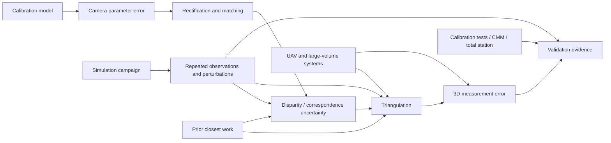

---
tags:
  - literature-list
  - simulation
  - zotero
---

# Simulation — 30편 문헌 목록

## 선정 기준

Simulation 논문 후보는 캘리브레이션, triangulation, stereo matching, 파라미터 오차, 측정 불확실도, 시스템 성능 검증에 직접 연결되는 peer-reviewed journal/conference papers 30편으로 구성했다. 기존 Simulation collection의 9편을 유지하고 21편을 보탰다. 기존 서적 장 `Bundle Adjustment—A Modern Synthesis`와 Technical references는 30편에서 제외한다.

IF는 해당 저널 전체의 지표다. 개별 논문 점수로 해석하지 않는다. 학회 논문은 peer-reviewed 여부와 주제 적합도로 포함했으며 journal JIF는 적용되지 않는다. JIF 값이 출판사에 표시되지만 측정 연도가 안 보이는 경우 그 상태를 그대로 표시한다.

## 핵심 연결

## 30편 목록

| # | 논문 | 저널/학회, 연도 | JIF | SASL Simulation과의 연결 |
|---:|---|---|---|---|
| 1 | [A Flexible New Technique for Camera Calibration — Zhang](https://doi.org/10.1109/34.888718) | IEEE TPAMI, 2000 | 20.4 (2025 JIF) | 평면 패턴 기반 intrinsic/extrinsic calibration의 기본 비교점. |
| 2 | [Triangulation — Hartley & Sturm](https://doi.org/10.1006/cviu.1997.0547) | Computer Vision and Image Understanding, 1997 | 4.5 (출판사 현재 표시) | 대응점 오차가 있을 때 두-view 3D 교차점을 구하는 triangulation 기준. |
| 3 | [Revisiting Stereo Triangulation in UAV Distance Estimation — Zhuang et al.](https://doi.org/10.3390/s26154798) | Sensors, 2026 | 4.0 (2025 JIF) | UAV stereo 거리 추정과 ray-scale 보정 문헌. 본 저장소의 가장 가까운 range-estimation 비교 후보. |
| 4 | [A data-fusion approach to motion-stereo — Malapelle et al.](https://doi.org/10.1016/j.image.2016.02.003) | Signal Processing: Image Communication, 2016 | 2.1 (출판사 현재 표시) | 시간·공간 관측을 결합하는 motion-stereo 방법 비교. |
| 5 | [Learning the Distribution of Errors in Stereo Matching for Joint Disparity and Uncertainty Estimation — Chen et al.](https://openaccess.thecvf.com/content/CVPR2023/html/Chen_Learning_the_Distribution_of_Errors_in_Stereo_Matching_for_Joint_CVPR_2023_paper.html) | CVPR, 2023 | 해당 없음 — 학회 논문 | disparity 예측과 오차 분포를 함께 추정하는 최근 learned baseline. |
| 6 | [Factorial-Design-Based Uncertainty Analysis for Stereo-Vision Photogrammetry — Ren et al.](https://doi.org/10.1109/TIM.2023.3328705) | IEEE TIM, 2023 | 7.0 (출판사 현재 표시; 연도 미표기) | factorial design으로 triangulation 불확실도를 계산하고 Monte Carlo와 비교한다. |
| 7 | [Ground Stereo Vision-Based Navigation for Autonomous Take-off and Landing of UAVs — Tang et al.](https://doi.org/10.5772/62027) | International Journal of Advanced Robotic Systems, 2016 | 2.1 (SAGE publisher display; metric year 미표기) | ground stereo를 UAV landing/navigation에 적용한 응용 범위 참고. |
| 8 | [Localization Framework for Real-Time UAV Autonomous Landing — Kong et al.](https://doi.org/10.3390/s17061437) | Sensors, 2017 | 4.0 (2025 JIF) | on-ground visual localization을 UAV landing에 적용한 시스템 맥락. |
| 9 | [Uncertainty model for a traceable stereo-photogrammetry system — Sims-Waterhouse et al.](https://doi.org/10.1016/j.precisioneng.2019.12.008) | Precision Engineering, 2020 | 3.7 (출판사 현재 표시) | traceable scale calibration과 Monte Carlo uncertainty model 비교. |
| 10 | [VDI/VDE 2634-1 Performance Evaluation Tests and Systematic Errors in Passive Stereo Vision Systems — Jaganmohan et al.](https://doi.org/10.1016/j.precisioneng.2022.11.005) | Precision Engineering, 2023 | 3.7 (출판사 현재 표시) | 26개 camera parameter systematic error가 length test에 미치는 영향을 시뮬레이션과 CMM 조건에서 분석한다. |
| 11 | [Estimation of Measurement Uncertainty in Stereo Vision System — Sankowski et al.](https://doi.org/10.1016/j.imavis.2017.02.005) | Image and Vision Computing, 2017 | 4.7 (출판사 현재 표시) | checkerboard 측정으로 XYZ 불확실도와 recalibration 필요성을 점검하는 절차. |
| 12 | [Effects of Camera Alignment Errors on Stereoscopic Depth Estimates — Zhao & Nandhakumar](https://doi.org/10.1016/S0031-3203(96)00051-9) | Pattern Recognition, 1996 | 7.6 (출판사 현재 표시) | calibration/alignment 파라미터 오차와 3D depth 오차의 민감도 관계. |
| 13 | [Stereo Vision for 3D Measurement: Accuracy Analysis, Calibration and Industrial Applications — Aguilar et al.](https://doi.org/10.1016/S0263-2241(96)00065-6) | Measurement, 1996 | 6.1 (출판사 현재 표시; 연도 미표기) | CMM 및 calibration object로 stereo measurement의 error limit를 검증한 산업 계측 사례. |
| 14 | [A Comparative Review of Camera Calibrating Methods with Accuracy Evaluation — Salvi et al.](https://doi.org/10.1016/S0031-3203(01)00126-1) | Pattern Recognition, 2002 | 7.6 (출판사 현재 표시) | calibration 방식별 정확도 평가를 같은 표기법으로 비교하는 배경 문헌. |
| 15 | [Camera Calibration with Distortion Models and Accuracy Evaluation — Weng et al.](https://doi.org/10.1109/34.159901) | IEEE TPAMI, 1992 | 20.4 (2025 JIF) | radial/decentering/thin-prism distortion을 포함한 calibration과 오차 평가. |
| 16 | [A Versatile Camera Calibration Technique for High-Accuracy 3-D Machine Vision Metrology — Tsai](https://doi.org/10.1109/JRA.1987.1087109) | IEEE Journal of Robotics and Automation, 1987 | 현재 저널 JIF 미적용 | off-the-shelf camera의 intrinsic/extrinsic을 두 단계로 계산한 고전 metrology 방법. |
| 17 | [Techniques for Calibration of the Scale Factor and Image Center — Lenz & Tsai](https://doi.org/10.1109/34.6781) | IEEE TPAMI, 1988 | 20.4 (2025 JIF) | scale factor와 image center 보정이 실제 3D measurement에 미치는 영향. |
| 18 | [A Compact Algorithm for Rectification of Stereo Pairs — Fusiello et al.](https://doi.org/10.1007/s001380050003) | Machine Vision and Applications, 2000 | 미확인 | 임의 stereo rig의 rectification과 rectified image 기반 reconstruction 비교. |
| 19 | [A Taxonomy and Evaluation of Dense Two-Frame Stereo Correspondence Algorithms — Scharstein & Szeliski](https://doi.org/10.1023/A:1014573219977) | International Journal of Computer Vision, 2002 | 미확인 | dense stereo 방법과 데이터셋을 비교하는 benchmark 설계 참고. |
| 20 | [Stereo Processing by Semiglobal Matching and Mutual Information — Hirschmüller](https://doi.org/10.1109/TPAMI.2007.1166) | IEEE TPAMI, 2008 | 20.4 (2025 JIF) | SGM, mutual-information matching cost, subpixel refinement의 고전 비교점. |
| 21 | [Stereo Matching in the Presence of Sub-Pixel Calibration Errors — Hirschmüller & Gehrig](https://doi.org/10.1109/CVPR.2009.5206493) | CVPR, 2009 | 해당 없음 — 학회 논문 | 0.25-pixel급 calibration 오차가 구조에 따라 disparity 오류를 키울 수 있음을 평가한다. |
| 22 | [High-Resolution Stereo Datasets with Subpixel-Accurate Ground Truth — Scharstein et al.](https://doi.org/10.1007/978-3-319-11752-2_3) | GCPR, 2014 | 해당 없음 — 학회 논문 | subpixel ground-truth disparity와 rectification accuracy를 평가하는 데이터셋 방법. |
| 23 | [Stereo Camera Calibration for Large Field of View Digital Image Correlation Using Zoom Lens — Gao et al.](https://doi.org/10.1016/j.measurement.2021.109999) | Measurement, 2021 | 6.1 (출판사 현재 표시; 연도 미표기) | 넓은 FOV에서 zoom lens와 calibration board를 조합한 calibration, 약 6×6 m 장면 검증. |
| 24 | [Highly Accurate Three-Dimensional Measurement of Large Structures Using Multiple Stereo Vision — Kim et al.](https://doi.org/10.1016/j.measurement.2024.114886) | Measurement, 2024 | 6.1 (출판사 현재 표시; 연도 미표기) | 여러 stereo rig와 향상된 two-step calibration을 대형 구조물 실측 및 total station과 비교. |
| 25 | [Research on Evaluation Method of Stereo Vision Measurement System Based on Parameter-Driven — Zhang et al.](https://doi.org/10.1016/j.ijleo.2021.167737) | Optik, 2021 | 3.1 (출판사 현재 표시) | camera parameter와 stereo layout이 measurement error에 미치는 영향을 모델링하고 parameter 선택을 안내한다. |
| 26 | [Calibration Accuracy Evaluation Method for Multi-Camera Measurement Systems — Yuan et al.](https://doi.org/10.1016/j.measurement.2024.116311) | Measurement, 2025 | 6.1 (출판사 현재 표시; 연도 미표기) | multi-camera extrinsic registration의 residual 기반 calibration quality 지표. |
| 27 | [A Cross-Target-Based Accurate Calibration Method of Binocular Stereo Systems with Large-Scale Field-of-View — Xiao et al.](https://doi.org/10.1016/j.measurement.2010.01.017) | Measurement, 2010 | 6.1 (출판사 현재 표시; 연도 미표기) | cross target, distortion model, bundle adjustment를 사용한 large-FOV binocular calibration과 CMM 검증. |
| 28 | [Telecentric Stereo Micro-Vision System: Calibration Method and Experiments — Chen et al.](https://doi.org/10.1016/j.optlaseng.2014.01.021) | Optics and Lasers in Engineering, 2014 | 5.0 (출판사 현재 표시; 연도 미표기) | telecentric stereo의 planar calibration 및 affine-camera 확장 사례. |
| 29 | [Uncertainty Quantification Framework for Aerial and UAV Photogrammetry Through Error Propagation — Huang & Qin](https://doi.org/10.1016/j.isprsjprs.2026.04.047) | ISPRS Journal of Photogrammetry and Remote Sensing, 2026 | 12.9 (출판사 현재 표시; 연도 미표기) | SfM/BA와 MVS 오차를 point covariance로 연결하고 disparity 불확실도를 추정한다. |
| 30 | [DRVEM-Net: A Deep Residual Volume Error Modeling Network for Stereo Vision System — Zhang et al.](https://doi.org/10.1016/j.measurement.2026.120726) | Measurement, 2026 | 6.1 (출판사 현재 표시; 연도 미표기) | calibrated stereo의 잔류 volumetric error를 simulated/real data에서 보정하는 최근 비교 방법. |

## JIF 참고 출처

- IEEE TPAMI: [IEEE Computer Society journal metrics](https://www.computer.org/publications) — 2025 JIF 20.4, JCR 2026 release.
- Sensors: [MDPI JIF announcement](https://www.mdpi.com/about/announcements/17120) — 2025 JIF 4.0, 2026년 6월 JCR release.
- IEEE TIM: [IEEE IMS TIM metrics](https://ieee-ims.org/publication/ieee-tim/metrics) — publisher's most-current JCR display 7.0; the page does not label the metric year beside the value.
- Measurement: [Elsevier Measurement journal page](https://www.sciencedirect.com/journal/measurement) — current display 6.1; metric year 미표기.
- Pattern Recognition: [Elsevier Pattern Recognition page](https://www.sciencedirect.com/journal/pattern-recognition) — current display 7.6; metric year 미표기.
- Precision Engineering: [Elsevier Precision Engineering page](https://www.sciencedirect.com/journal/precision-engineering) — current display 3.7; metric year 미표기.
- Image and Vision Computing: [Elsevier journal page](https://www.sciencedirect.com/journal/image-and-vision-computing) — current display 4.7; metric year 미표기.
- Computer Vision and Image Understanding: [Elsevier journal page](https://www.sciencedirect.com/journal/computer-vision-and-image-understanding) — current display 4.5; metric year 미표기.
- Signal Processing: Image Communication: [Elsevier journal page](https://www.sciencedirect.com/journal/signal-processing-image-communication) — current display 2.1; metric year 미표기.
- International Journal of Advanced Robotic Systems: [SAGE submission-guidelines PDF](https://www.sagepub.com/docs/default-source/msg/submission-guidelines_-international-journal-of-advanced-robotic-systems_-sage-journals.pdf?sfvrsn=979cdbbf_3) — publisher display 2.1; metric year 미표기.
- Optics & Laser Technology: [Elsevier journal page](https://www.sciencedirect.com/journal/optics-and-laser-technology) — current display 5.0; metric year 미표기.
- Optik: [Elsevier journal page](https://www.sciencedirect.com/journal/optik) — current display 3.1; metric year 미표기.
- ISPRS Journal of Photogrammetry and Remote Sensing: [official ISPRS journal page](https://www.isprs.org/isprsjournal/) — publisher display 12.9; metric year 미표기.

`미확인`은 JIF 값을 신뢰할 만한 공식 출처에서 이 조사 중 확인하지 못했음을 뜻한다. `해당 없음`은 학회 논문 또는 더 이상 발행되지 않는 저널이다.

## 저장소 연결

이 후보 목록은 [[Simulation - Multi-burst stereo]], [[Simulation - Calibration observability]], [[Existing Zotero stereo references]]와 함께 읽는다. SASL의 simulated sensor-model evidence를 실제 flight 실험 결과처럼 인용하지 않는다.

좌표 계약: OpenCV 픽셀은 `(u=right, v=down)`, disparity는 `left_u - right_u`, camera pose는 world ENU, output은 stereo-center FRD `[forward,right,down]` m다. PX4 local position NED `[north,east,down]`와 camera optical ray RDF를 같은 축으로 간주하지 않는다.
