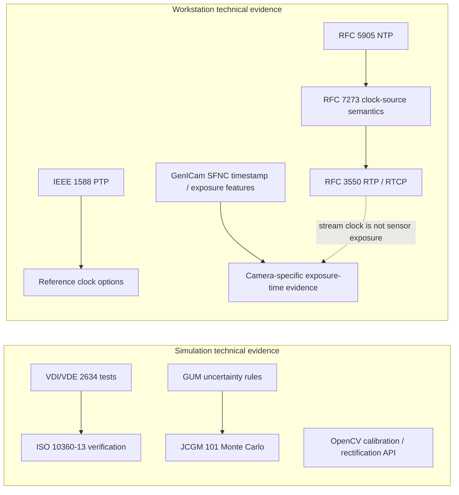

---
tags:
  - technical-reference
  - literature-map
---

# Technical references — 30편에 포함하지 않음

이 문서는 standards, protocol specifications, metrology guides, software documentation만 모은다. 이 항목들은 Simulation/Workstation 학술 논문 30편의 수에 포함하지 않는다. Zotero에서는 해당 주제 collection 안에 별도 `Technical reference` tag로 둔다.

## Simulation — optical 3D measurement and uncertainty

| Technical reference | Zotero key | 사용 목적 | 공식 출처 |
|---|---|---|---|
| ISO 10360-13:2021, Optical 3D CMS | `PKPTNDW6` | optical 3D coordinate measuring systems의 length acceptance / reverification test 범위 확인. 표면 조건이 cooperative range에 한정되는 적용 조건을 함께 기록. | [ISO](https://www.iso.org/standard/74957.html) |
| VDI/VDE 2634 Blatt 1:2002-05 | `9FRII9M7` | point-by-point imaging/triangulation 기반 optical 3D systems의 performance tests. | [DIN Media](https://www.dinmedia.de/en/technical-rule/vdi-vde-2634-blatt-1/47894462) |
| VDI/VDE 2634 Blatt 3:2008-12 | `GRVQEGHJ` | area-scanning triangulation과 multi-view optical 3D measurement systems의 test context. | [DIN Media](https://www.dinmedia.de/en/technical-rule/vdi-vde-2634-blatt-3/109737809) |
| JCGM 100:2008 (GUM) | `DMDRUHJW` | measurement uncertainty의 일반 평가·표현 규칙. | [BIPM](https://www.bipm.org/doi/10.59161/JCGM100-2008E) |
| JCGM 100:2008 Amendment 1:2026 | `Z6N8J5SI` | nonlinear measurement model을 다루는 GUM amendment. 분석 시 본문 2008 guide와 amendment 상태를 함께 확인. | [BIPM GUM guides](https://www.bipm.org/en/web/guest/publications/guides) |
| JCGM 101:2008 | `T8XSYG2R` | Monte Carlo method로 probability distribution을 propagate하는 supplementary guide. | [BIPM GUM guides](https://www.bipm.org/en/web/guest/publications/guides) |
| OpenCV `calib3d` documentation | `TGXF68ND` | camera calibration, stereo calibration, rectification, triangulation API 계약 확인. 라이브러리 구현 문서이며 peer-reviewed paper나 JIF 대상이 아니다. | [OpenCV camera calibration tutorial](https://docs.opencv.org/5.x/dc/dbb/tutorial_py_calibration.html), [calib3d API](https://docs.opencv.org/5.x/d9/d0c/group__calib3d.html) |

## Workstation — media clocks and camera timestamps

| Technical reference | Zotero key | 사용 목적 | 공식 출처 |
|---|---|---|---|
| RFC 3550, RTP: A Transport Protocol for Real-Time Applications | `PQM6RCY3` | RTP sequence/timestamp 및 RTCP Sender Report의 프로토콜 semantics. 기존 Workstation 항목이며 30편 밖에 둔다. | [IETF Datatracker](https://datatracker.ietf.org/doc/rfc3550/) |
| RFC 5905, Network Time Protocol Version 4 | `K2U8QTKP` | NTP system-clock synchronization protocol과 algorithm reference. | [RFC Editor](https://www.rfc-editor.org/info/rfc5905/) |
| RFC 7273, RTP Clock Source Signalling | `VC4P65EK` | RTP media clock과 timestamp reference clock이 다를 수 있음을 구분하고 source signalling을 정의. | [RFC Editor](https://www.rfc-editor.org/info/rfc7273/) |
| IEEE 1588-2019 (PTP v2.1) | `BX9T5ZUT` | Networked measurement/control systems의 precision clock synchronization protocol. PTP 지원 여부를 실제 device/driver별로 따로 확인. | [IEEE SA](https://standards.ieee.org/ieee/61588/10624/1588/6825/), [IEEE 1588 working group](https://sagroups.ieee.org/1588/public-documents/) |
| GenICam SFNC 2.8 | `P8ZTN6SE` | camera device feature naming/units reference. Timestamp 관련 feature는 ns 단위로 표준화됐지만 feature availability와 의미는 실제 camera model/firmware에 확인해야 함. | [EMVA downloads](https://www.emva.org/standards-technology/genicam/genicam-downloads/), [SFNC 2.8 release note](https://www.emva.org/news/genicam-working-group-updates/) |

## 관계와 적용 경계

RTCP/NTP and RTP media-clock regression against host monotonic receipt time establishes a relative stream/host clock relationship in the recorded run. It does not by itself establish the camera sensor's exposure start/end time. A separate camera-specific exposure or independent optical timing measurement is required for that claim.
