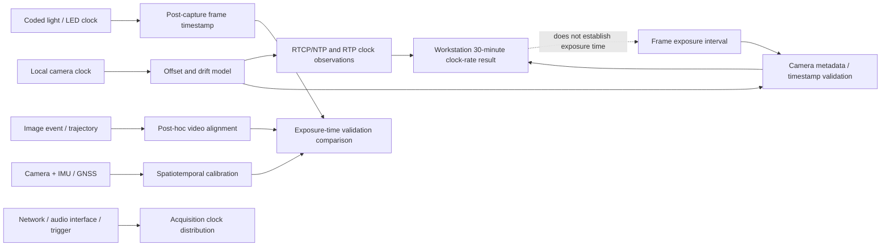

---
tags:
  - literature-list
  - workstation
  - zotero
---

# Workstation — 30편 문헌 목록

## 선정 기준

이 목록은 camera clock drift, RTP/RTCP clock observation, frame timestamp 복원, camera-network synchronization, visual-inertial temporal calibration, 멀티센서 acquisition의 시간 정합을 다루는 peer-reviewed journal/conference papers 30편이다. 기존 Workstation collection의 학술 논문 3편에 27편을 더한다. 기존 RFC 3550과 추가 Technical references는 30편에서 제외한다.

학회 논문은 peer-reviewed proceedings를 확인해 포함하며 journal JIF는 적용되지 않는다. JIF는 저널의 지표로서 개별 논문의 점수로 해석하지 않는다. 출판사 화면에 값만 있고 metric 연도가 없으면 연도를 추정하지 않았다.

## 관계도

## 30편 목록

| # | 논문 | 저널/학회, 연도 | JIF | Workstation과의 연결 |
|---:|---|---|---|---|
| 1 | [GNSS-based Time Synchronisation of Stereo Images — Gueguen et al.](https://doi.org/10.5194/isprs-archives-XLVIII-G-2025-535-2025) | ISPRS Archives, 2025 | 해당 없음 — proceedings | GNSS time reference를 이용한 stereo image time alignment. |
| 2 | [A Stereo Synchronization Method for Consumer-Grade Video Cameras — Seyfu & Yang](https://doi.org/10.3390/s25175535) | Sensors, 2025 | 4.0 (2025 JIF) | consumer camera image processing으로 multi-target displacement 시퀀스를 정렬한다. |
| 3 | [Subframe-Level Synchronization in Multi-Camera System Using Time-Calibrated Video — Zhou et al.](https://doi.org/10.3390/s24216975) | Sensors, 2024 | 4.0 (2025 JIF) | time-calibrated video를 이용한 subframe multi-camera synchronization. |
| 4 | [Sub-Frame Timestamping of a Camera Network Using a Coded Light Signal — Han et al.](https://doi.org/10.1016/j.measurement.2024.115046) | Measurement, 2024 | 6.1 (출판사 현재 표시; 연도 미표기) | coded LED 패턴에서 frame timestamp를 사후 복원하고 outdoor 오차를 평가한다. |
| 5 | [RocSync: Millisecond-Accurate Temporal Synchronization for Heterogeneous Camera Systems — Meyer et al.](https://doi.org/10.3390/s26031036) | Sensors, 2026 | 4.0 (2025 JIF) | LED Clock의 exposure window와 local clock의 offset/drift를 비교한다. |
| 6 | [Cameras as Clocks — Welty et al.](https://doi.org/10.3189/2013JoG12J126) | Journal of Glaciology, 2013 | 3.2 (2025 JIF) | consumer camera의 clock drift, timestamp resolution/precision과 UTC calibration을 다룬다. |
| 7 | [Sub-Frame Evaluation of Frame Synchronization for Camera Network Using Linearly Oscillating Light Spot — Kim & Ishikawa](https://doi.org/10.3390/s21186148) | Sensors, 2021 | 4.0 (2025 JIF) | 촬영된 oscillating light spot으로 frame synchronization을 sub-millisecond 수준 평가한다. |
| 8 | [Online Temporal Calibration Based on Modified Projection Model for Visual-Inertial Odometry — Liu & Meng](https://doi.org/10.1109/TIM.2019.2951863) | IEEE TIM, 2020 | 7.0 (출판사 현재 표시; 연도 미표기) | EKF state에 camera–IMU time offset을 포함하는 online calibration. |
| 9 | [VersaVIS—An Open Versatile Multi-Camera Visual-Inertial Sensor Suite — Tschopp et al.](https://doi.org/10.3390/s20051439) | Sensors, 2020 | 4.0 (2025 JIF) | 다중 camera/IMU triggering, exposure compensation, host-clock translation을 가진 hardware/software suite. |
| 10 | [Self-Calibration of Omnidirectional Multi-Cameras Including Synchronization and Rolling Shutter — Nguyen & Lhuillier](https://doi.org/10.1016/j.cviu.2017.08.010) | Computer Vision and Image Understanding, 2017 | 4.5 (출판사 현재 표시) | 360° camera의 time offset, line delay, pose와 intrinsic parameter를 함께 추정한다. |
| 11 | [Cost-Effective Solution to Synchronised Audio-Visual Data Capture Using Multiple Sensors — Lichtenauer et al.](https://doi.org/10.1016/j.imavis.2011.07.004) | Image and Vision Computing, 2011 | 4.7 (출판사 현재 표시) | 독립 clock의 offset/rate, trigger signal, timestamp 출처를 다중채널 audio interface로 기록하는 acquisition 설계. |
| 12 | [Video Synchronization Based on Events Alignment — Liu et al.](https://doi.org/10.1016/j.patrec.2012.02.009) | Pattern Recognition Letters, 2012 | 5.1 (출판사 현재 표시) | motion event correspondence와 최적화를 이용해 서로 다른 frame rate에서 subframe align한다. |
| 13 | [Efficient Video Sequences Alignment Using Unbiased Bidirectional Dynamic Time Warping — Lu et al.](https://doi.org/10.1016/j.jvcir.2011.06.003) | Journal of Visual Communication and Image Representation, 2011 | 2.6 (출판사 현재 표시) | 방향 bias 없는 dynamic time warping으로 비디오의 가변 시간 오프셋을 맞춘다. |
| 14 | [Temporal Synchronization of Non-Overlapping Videos Using Known Object Motion — Brito et al.](https://doi.org/10.1016/j.patrec.2010.02.011) | Pattern Recognition Letters, 2010 | 5.1 (출판사 현재 표시) | 시야가 겹치지 않는 고정 camera 간 time relation을 공통 이동 물체 궤적으로 추정한다. |
| 15 | [Time Synchronization of Consumer Cameras on Micro Aerial Vehicles — Skaloud & Rehak](https://doi.org/10.1016/j.isprsjprs.2016.11.009) | ISPRS Journal of Photogrammetry and Remote Sensing, 2017 | 12.9 (출판사 현재 표시; 연도 미표기) | consumer camera와 GNSS/IMU의 residual time delay를 aerial control로 추정한다. |
| 16 | [A Novel Motion-Based Online Temporal Calibration Method for Multi-Rate Sensors Fusion — Liu et al.](https://doi.org/10.1016/j.inffus.2022.07.004) | Information Fusion, 2022 | 18.6 (출판사 현재 표시) | high-rate IMU를 기준으로 다른 sensor의 temporal offset을 online 추정한다. |
| 17 | [3-D Motion Estimation and Online Temporal Calibration for Camera-IMU Systems — Li & Mourikis](https://doi.org/10.1109/ICRA.2013.6631398) | ICRA, 2013 | 해당 없음 — proceedings | camera–IMU time offset을 EKF state에서 pose/extrinsic과 함께 online 추정한다. |
| 18 | [Online Temporal Calibration for Camera-IMU Systems: Theory and Algorithms — Li & Mourikis](https://doi.org/10.1177/0278364913515286) | The International Journal of Robotics Research, 2014 | 7.7 (SAGE publisher display; metric 연도 미표기) | offset의 식별 가능성과 degenerate motion 조건을 분석하고 constant/time-varying offset을 평가한다. |
| 19 | [Online Temporal Calibration of Camera and IMU Using Nonlinear Optimization — Liu et al.](https://doi.org/10.1109/ICPR.2018.8546297) | ICPR, 2018 | 해당 없음 — proceedings | sliding-window nonlinear optimization으로 low-cost camera/IMU timestamp delay를 추정한다. |
| 20 | [Unified Temporal and Spatial Calibration for Multi-Sensor Systems — Furgale et al.](https://doi.org/10.1109/IROS.2013.6696514) | IROS, 2013 | 해당 없음 — proceedings | continuous-time batch maximum-likelihood framework에서 time offset과 spatial transform을 joint 추정한다. |
| 21 | [A General Approach to Spatiotemporal Calibration in Multisensor Systems — Rehder et al.](https://doi.org/10.1109/TRO.2016.2529645) | IEEE Transactions on Robotics, 2016 | 11.1 (2025 JIF) | camera–IMU 및 stereo camera–laser range finder의 spatial/temporal calibration. |
| 22 | [Temporal Calibration in Multisensor Tracking Setups — Huber et al.](https://doi.org/10.1109/ISMAR.2009.5336465) | ISMAR, 2009 | 해당 없음 — proceedings | 서로 다른 tracking sensor 간 temporal offset을 normalized cross-correlation으로 추정한다. |
| 23 | [Camera Network Calibration and Synchronization from Silhouettes in Archived Video — Sinha & Pollefeys](https://doi.org/10.1007/s11263-009-0269-2) | International Journal of Computer Vision, 2010 | 미확인 | archived video의 silhouette motion에서 camera geometry와 synchronization을 함께 복원한다. |
| 24 | [Video Synchronization and Its Application to Object Transfer — Cao et al.](https://doi.org/10.1016/j.imavis.2009.04.015) | Image and Vision Computing, 2010 | 4.7 (출판사 현재 표시) | 다른 장면의 비디오도 camera motion ratio로 temporal align하는 post-production 비교법. |
| 25 | [Feature-Based Multi-Video Synchronization with Subframe Accuracy — Elhayek et al.](https://doi.org/10.1007/978-3-642-32717-9_27) | DAGM/GCPR, 2012 | 해당 없음 — proceedings | feature trajectory와 RANSAC으로 여러 비디오의 subframe alignment를 구한다. |
| 26 | [On the Two-View Geometry of Unsynchronized Cameras — Albl et al.](https://doi.org/10.1109/CVPR.2017.593) | CVPR, 2017 | 해당 없음 — proceedings | unknown temporal shift를 포함한 two-view fundamental matrix/homography 추정. |
| 27 | [Rolling Shutter Camera Synchronization with Sub-Millisecond Accuracy — Šmíd & Matas](https://doi.org/10.5220/0006175402380245) | VISAPP, 2017 | 해당 없음 — proceedings | rolling-shutter row delay와 flash event를 이용해 비중첩 camera도 align한다. |
| 28 | [Sub-Millisecond Video Synchronization of Multiple Android Smartphones — Akhmetyanov et al.](https://doi.org/10.1109/SENSORS47087.2021.9639782) | IEEE Sensors, 2021 | 해당 없음 — proceedings | Android timestamp model과 47기기 검증으로 smartphone camera sync/drift를 평가한다. |
| 29 | [Wireless Software Synchronization of Multiple Distributed Cameras — Ansari et al.](https://doi.org/10.1109/ICCPHOT.2019.8747340) | ICCP, 2019 | 해당 없음 — proceedings | Wi-Fi network delay로 device clock을 맞춘 뒤 camera timestamp phase를 정렬한다. |
| 30 | [Syntalos: A Software for Precise Synchronization of Simultaneous Multi-Modal Data Acquisition — Klumpp et al.](https://doi.org/10.1038/s41467-025-56081-9) | Nature Communications, 2025 | 18.1 (2025 JIF) | CLOCK_MONOTONIC master clock에 장치 clock을 정렬하고 24시간 이상 동기를 평가한 acquisition software. |

## IF 참고 출처

- Sensors: [2025 JIF 4.0, JCR 2026 release](https://www.mdpi.com/about/announcements/17120).
- Measurement: [Elsevier journal page](https://www.sciencedirect.com/journal/measurement) — current display 6.1, metric year 미표기.
- IEEE TIM: [IEEE IMS metrics](https://ieee-ims.org/publication/ieee-tim/metrics) — most-current JCR display 7.0, metric year beside the value not stated.
- Information Fusion: [Elsevier journal page](https://www.sciencedirect.com/journal/information-fusion) — current display 18.6, metric year 미표기.
- Image and Vision Computing: [Elsevier journal page](https://www.sciencedirect.com/journal/image-and-vision-computing) — current display 4.7, metric year 미표기.
- Computer Vision and Image Understanding: [Elsevier journal page](https://www.sciencedirect.com/journal/computer-vision-and-image-understanding) — current display 4.5, metric year 미표기.
- Pattern Recognition Letters: [Elsevier journal page](https://www.sciencedirect.com/journal/pattern-recognition-letters) — current display 5.1, metric year 미표기.
- Journal of Visual Communication and Image Representation: [Elsevier journal page](https://www.sciencedirect.com/journal/journal-of-visual-communication-and-image-representation) — current display 2.6, metric year 미표기.
- ISPRS Journal of Photogrammetry and Remote Sensing: [official ISPRS page](https://www.isprs.org/isprsjournal/) — current display 12.9, metric year 미표기.
- Journal of Glaciology: [Cambridge metrics](https://www.cambridge.org/core/journals/journal-of-glaciology/information/about-this-journal/journal-metrics) — 2025 JIF 3.2.
- IJRR: [SAGE journal page](https://services.sagepub.com/journal/international-journal-of-robotics-research/) — publisher display 7.7; metric year not shown in the accessed source.
- IEEE T-RO: [IEEE RAS journal page](https://www.ieee-ras.org/publications/t-ro/) — 2025 JIF 11.1.
- Nature Communications: [Nature metrics](https://www.nature.com/ncomms/ncomms/journal-impact) — 2025 JIF 18.1.

## Workstation 결과와 연결할 때

저장소의 30분 결과는 RTCP Sender Report의 NTP/RTP clock rate를 host monotonic receipt time에 대해 회귀한 relative clock observation이다. 이는 camera sensor exposure time을 직접 측정한 결과가 아니다. Cameras-as-clocks, coded-light/RocSync, hardware/IMU calibration, post-capture video alignment 문헌은 각각 서로 다른 시간층을 다루므로 그 차이를 유지한다.

저장소 시간 계약: `RTCP/NTP Sender Report time` 및 `unwrapped RTP tick`을 `host monotonic receipt time`과 비교한다. 이 결과만으로 exposure start/end, frame capture instant, 또는 stereo position accuracy를 주장하지 않는다.
