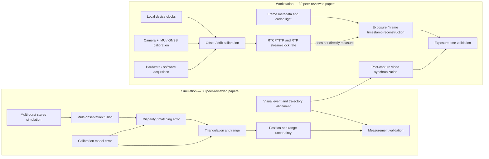

---
tags:
  - literature-map
  - sasl
---

# 논문 후보와 문헌 관계도

이 저장소 루트에는 `.obsidian/` 설정과 Obsidian 시작점인 `docs/PROJECT_INDEX.md`가 있어 기존 vault로 확인했습니다. 이 문서와 연결된 노트들이 Obsidian graph의 문헌 부분을 구성합니다.

처음 읽을 때 필요한 좌표·시간·지표 개념과 읽기 순서는 [[Reading guide]]에 모았습니다.

## 주제별 30편 문헌 목록

- [[Simulation - 30 papers]] — stereo triangulation, calibration, matching error, uncertainty, measurement validation에 관한 학술 논문 30편.
- [[Workstation - 30 papers]] — camera clock drift, frame timestamp reconstruction, sensor temporal calibration, video synchronization에 관한 학술 논문 30편.
- [[Technical references]] — standards, RFC, metrology guides, library documentation. 위 30편 수에 포함하지 않는다.

실험 후보와 직접 연결된 저장소 근거 노트도 함께 본다.

- [[Simulation - Multi-burst stereo]] — 합성 스트레스 조건에서 다중 관측 융합과 disparity 기반 ray-scale 잔차 보정.
- [[Simulation - Calibration observability]] — stereo, IMU, RTK 제약과 비행 경로가 카메라 자세 추정에 미치는 영향.
- [[Workstation - Camera clock drift]] — RTCP Sender Report의 NTP/RTP clock rate를 host monotonic time과 비교한 30분 상대 드리프트 관측.
- [[Workstation - Integrated field reliability]] — 공유 Ethernet에서 카메라, Pixhawk, NTRIP 연결 지속성을 평가.

## IF 해석

목록의 IF는 저널 수준 metric이다. 논문의 방법·데이터·평가가 본 연구 질문에 얼마나 가까운지를 먼저 보고, IF는 journal context로 참고한다. 학회 proceedings는 peer-reviewed라도 journal JIF가 적용되지 않는다.

## Novelty 기록 방식

각 후보의 novelty는 현재 **가설**로 기록한다. 가장 가까운 논문과 겹치는 부분, SASL 결과가 보여주는 차이, 아직 확인하지 못한 주장, 이를 검증할 실험을 분리한다. 현재 어느 후보도 문헌 공백이나 최초성을 확인한 상태가 아니다.

## 관계도

## Zotero

2026-10-20에 Zotero 10 local API로 두 collection을 업데이트하고 다시 읽어 확인했다. `Simulation` collection key `9EUARULB`에는 학술지/학회 논문 30편, Technical references 7건이 있다. `Workstation` collection key `6SGRDB2A`에는 학술지/학회 논문 30편, Technical references 5건이 있다. Workstation의 Technical 5건 중 RFC 3550 1건은 기존 항목이고 4건을 새로 추가했다. Simulation의 `Bundle Adjustment—A Modern Synthesis` 서적 장, 양쪽 collection의 child note와 Workstation RFC는 각각 별도 항목이며 논문 30편 수에는 포함하지 않는다.

기존 라이브러리 기록 중 초기 7개 reference는 다음과 같이 분리되어 있다.

| Reference | Zotero item key | BibTeX key | Collection |
| --- | --- | --- | --- |
| Zhuang et al. (2026) | `QJRBC6AD` | `zhuang_revisiting_2026` | Simulation |
| Malapelle et al. (2016) | `FQ93K62Z` | `malapelle_data-fusion_2016` | Simulation |
| Chen et al. (2023) | `ZS2APR7A` | `chen_learning_2023` | Simulation |
| Gueguen et al. (2025) | `5CXCS3G9` | `gueguen_gnss-based_2025` | Workstation |
| Seyfu & Yang (2025) | `4INHI5UA` | `seyfu_stereo_2025` | Workstation |
| Zhou et al. (2024) | `HAN97J6V` | `zhou_subframe-level_2024` | Workstation |
| RFC 3550 (2003) | `PQM6RCY3` | `schulzrinne_rtp_2003` | Workstation |

신규 논문과 Technical records는 publisher/official proceedings/official repositories의 citation metadata를 대조해 Zotero에 추가했다. 공개 초록으로 목록 적합성을 선별했으며, 개별 논문을 자세히 읽고 방법·결과·제한을 요약하는 Zotero child note는 이번 작업에서 새로 만들지 않았다.

## Existing Zotero records to reuse

[[Existing Zotero stereo references]] lists existing camera calibration, triangulation, and uncertainty references. They were not re-imported. Dataset/measurement standards and protocol papers are listed in [[Technical references]] and remain outside each 30-paper count.

